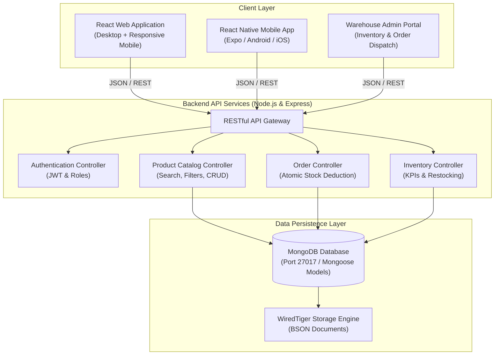

# 🥦 FreshCart - Full-Stack MERN Grocery Delivery Platform

[](https://nodejs.org/)
[](https://react.dev/)
[](https://www.mongodb.com/)
[](https://expressjs.com/)
[](https://opensource.org/licenses/MIT)

> **FreshCart** is a modern, production-grade hyperlocal grocery delivery and warehouse inventory management platform built using the complete **MERN Stack** (MongoDB, Express.js, React, Node.js) with a companion **React Native** mobile application.

---

## 🌟 Key Features

### 🛒 Customer Storefront (Web & Mobile)
- **Instant Search & Category Filtering**: Real-time debounced search and category badges across *Fruits & Vegetables*, *Dairy & Breakfast*, *Staples & Grains*, *Snacks & Drinks*, and *Household & Personal*.
- **Dynamic Stock Status**: Automatic visual indicators (`In Stock`, `Only X Left!`, and `Out of Stock`) synchronized with warehouse levels.
- **Interactive Shopping Basket**: Real-time quantity steppers (`+` / `-`), auto-calculated delivery fee (Free above ₹499), and threshold alerts.
- **Checkout & Multi-Mode Payments**: Delivery address form supporting Cash on Delivery (COD), UPI (GPay / PhonePe), and Cards.

### 🛵 Live Order Tracking & Dispatch
- **Visual 4-Stage Progress Stepper**: Real-time order lifecycle tracking: `Placed` ➔ `Packing` ➔ `Out for Delivery` ➔ `Delivered`.
- **Delivery Verification PIN**: Unique 4-digit OTP generated per order for secure delivery confirmation.
- **Rider Allocation**: Displays delivery partner details and estimated time of arrival.

### 📦 Warehouse Inventory & Admin Dashboard
- **Atomic Stock Deduction**: Automatically decrements product inventory on checkout and prevents overselling.
- **Live Warehouse KPIs**: High-level metrics tracking Total SKUs, Low Stock alerts (< 10 units), Out of Stock count, and total warehouse valuation in ₹ INR.
- **1-Click Restocking**: Instant stock replenishment (`+15 units`) via dedicated REST endpoint.
- **Full CRUD Management**: Create, Read, Update (edit price/stock), and Delete items directly in MongoDB.

### 🔐 Authentication & Role-Based Access Control
- **Startup Authentication Portal**: Greets users on launch with Customer Login, Store Manager (Admin) Login, and New Account Registration.
- **1-Click Demo Profiles**: Quick-switch demo buttons for instant testing.
- **Protected Routes**: Restricts warehouse inventory and CRUD management to authenticated Store Managers.

### 📱 Cross-Platform Architecture
- **Responsive Single-Page Web App**: Built with React 18, CSS Grid, Flexbox, and an interactive **Smartphone Simulator Frame** toggle directly in the browser.
- **React Native Mobile App**: Standalone mobile application in `mobile/` compatible with Expo, Android, and iOS.

---

## 🏗️ System Architecture



---

## 🛠️ Tech Stack

- **Frontend (Web)**: React 18, Semantic HTML5, Modern CSS3 (Grid & Flexbox), Plus Jakarta Sans typography.
- **Frontend (Mobile)**: React Native, Expo, React Navigation, StyleSheet.
- **Backend**: Node.js (v20+), Express.js (v4.19+), RESTful Architecture.
- **Database**: MongoDB (v4.4+ / v7+ / Atlas Cloud), Mongoose ODM (v8.3+).
- **Testing**: Node.js Automated Integration Test Suite (17 unit and integration assertions).
- **API Documentation**: Postman Collection (v2.1).

---

## 📁 Project Directory Structure

```
freshcart-grocery-mern/
├── .env                             # Active environment configuration
├── .gitignore                       # Git ignore specifications
├── package.json                     # Project manifest and scripts
├── README.md                        # Documentation
├── FreshCart_Postman_Collection.json# Complete Postman REST API collection
├── run-server.bat                   # 1-click server launch script
├── run-server.ps1                   # PowerShell server launch script
├── start-mongodb.bat                # 1-click local MongoDB daemon launcher
├── open-mongo-shell.bat             # 1-click MongoDB shell client launcher
│
├── backend/
│   ├── config/
│   │   └── db.js                    # MongoDB connection configuration
│   ├── controllers/
│   │   ├── authController.js        # Authentication & user profile handling
│   │   ├── productController.js     # Catalog search, category filters, and CRUD
│   │   ├── orderController.js       # Order creation, atomic stock deduction, tracking
│   │   └── inventoryController.js   # Stock monitoring, alerts, and restocking
│   ├── models/
│   │   ├── Product.js               # Mongoose schema for grocery items
│   │   ├── Order.js                 # Mongoose schema for orders & timeline
│   │   ├── User.js                  # Mongoose schema for user accounts
│   │   └── Category.js              # Mongoose schema for product categories
│   ├── routes/
│   │   ├── authRoutes.js
│   │   ├── productRoutes.js
│   │   ├── orderRoutes.js
│   │   └── inventoryRoutes.js
│   ├── data/
│   │   ├── sampleProducts.json      # Pre-loaded grocery catalog
│   │   └── seed.js                  # Database seeder script
│   ├── tests/
│   │   └── api.test.js              # Automated integration test runner (17 tests)
│   └── server.js                    # Express application entry point
│
├── frontend/
│   ├── index.html                   # Web application entry point
│   ├── css/
│   │   └── styles.css               # Responsive styling and phone frame simulator
│   └── js/
│       ├── api.js                   # Asynchronous Fetch REST client
│       └── app.js                   # React components (Storefront, Cart, Admin, Tracker)
│
├── mobile/                          # React Native Mobile Application
│   ├── App.js                       # Mobile application entry point
│   ├── app.json                     # Expo configuration
│   ├── package.json                 # Mobile dependencies
│   ├── screens/                     # HomeScreen, CartScreen, OrderTrackingScreen, InventoryScreen
│   ├── components/                  # ProductCard native component
│   └── README.md                    # Mobile setup & run instructions
│
└── docs/
    └── ARCHITECTURE_AND_FAQ.md      # System architecture, design decisions & FAQ
```

---

## ⚡ Quick Start Guide

### 1. Start MongoDB
Double-click `start-mongodb.bat` or run:
```powershell
.\start-mongodb.bat
```
*(Starts the local MongoDB daemon on `127.0.0.1:27017`)*

### 2. Start the Full-Stack Server
Double-click `run-server.bat` or run:
```powershell
.\run-server.bat
```
*(Or in VS Code, press **`F5`**)*

Open your browser to:  
👉 **`http://localhost:5000`**

### 3. Open MongoDB Shell (Optional)
To inspect the live database:
```powershell
.\open-mongo-shell.bat
```

### 4. Run Automated Test Suite
```powershell
node backend/tests/api.test.js
```
*Output: All 17 automated integration assertions pass with 100% success.*

### 5. Run React Native Mobile App (Optional)
```powershell
cd mobile
npm install
npx expo start
```
Scan the QR code with **Expo Go** on Android or iOS.

---

## 📡 REST API Reference

| Method | Endpoint | Description |
|---|---|---|
| `GET` | `/api/health` | Health dashboard reporting active MongoDB connection |
| `GET` | `/api/products` | Get products (supports `?category=...&search=...&sort=...`) |
| `GET` | `/api/products/:id` | Get individual product details |
| `POST` | `/api/products` | Create new grocery product (Admin) |
| `PUT` | `/api/products/:id` | Update product details / price (Admin) |
| `DELETE` | `/api/products/:id` | Remove product from database (Admin) |
| `GET` | `/api/inventory/stats` | Warehouse overview, low stock alerts, valuation |
| `PATCH` | `/api/inventory/:id/restock` | Restock product inventory count |
| `GET` | `/api/orders` | View all customer orders (Admin) |
| `POST` | `/api/orders` | Place grocery order (validates & decrements stock) |
| `GET` | `/api/orders/:idOrNumber` | Live order tracking by ID or Order Number |
| `PATCH` | `/api/orders/:id/status` | Transition order status (`Placed` ➔ `Packing` ➔ `Out for Delivery` ➔ `Delivered`) |
| `DELETE` | `/api/orders/:id` | Remove order record (Admin) |
| `POST` | `/api/auth/login` | User login (`admin@freshcart.com` / `admin123`) |
| `POST` | `/api/auth/register` | Register new customer account |

---

## 📄 License
This project is open-source under the [MIT License](LICENSE).
