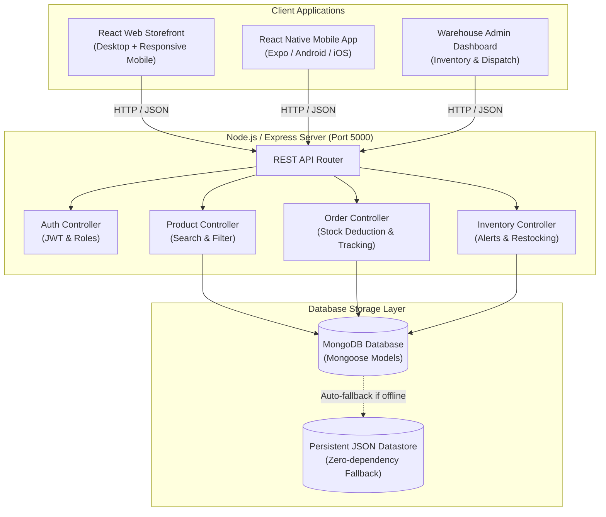

# 🥦 FreshCart - Full-Stack MERN Grocery Delivery & Inventory Management Platform

> **Second Year Skill Lab: Full Stack Development — Capstone Project (Hackathon)**  
> **Department of Computer Science and Engineering — RV Institutions (RVCE)**  
> **Curriculum Alignment**: Day 1 (HTML/CSS) ➔ Day 2 (JS/APIs) ➔ Day 3 (Node/Express/Postman) ➔ Day 4 (MongoDB) ➔ Day 5 (Git/Testing/Demo)

---

## 🌟 Project Overview

**FreshCart** is a modern, high-performance grocery delivery application built using the complete **MERN Stack** (MongoDB, Express.js, React, Node.js) paired with a companion **React Native** mobile application.

It simulates a real-world hyper-local 15-minute quick-commerce workflow (similar to Blinkit / Zepto / Instamart), featuring:
1. **Dynamic Customer Storefront**: Instant search, category filters, live stock status tags, and shopping basket.
2. **Atomic Inventory Deduction**: Automatically decrements product stock on order placement; prevents overselling.
3. **Warehouse & Inventory Dashboard**: Low-stock warnings (<10 units), out-of-stock tracking, warehouse valuation, and 1-click restocking.
4. **Live Order Tracking**: 4-step animated status progression (`Placed` ➔ `Packing` ➔ `Out for Delivery` ➔ `Delivered`) with delivery OTP and partner assignment.
5. **Multi-Platform Frontend**:
   - Modern **React Web App** with built-in Smartphone Simulator Frame toggle.
   - Dedicated **React Native** mobile application (`mobile/App.js`) for Android and iOS via Expo.
6. **Dual Database Engine**: Connects to **MongoDB** (via Mongoose) when available, and automatically falls back to an embedded persistent JSON datastore (`backend/data/db.json`) for 100% crash-free lab demos without external database setup.

---

## 🏗️ System Architecture



---

## 📋 Course Curriculum Alignment (Day 1 - Day 5)

| Day | Topic | Skill Lab Practical | FreshCart Implementation |
|---|---|---|---|
| **Day 1** | Web Fundamentals, HTML, CSS, Responsive Design | Portfolio + Git basics | Semantic HTML5 structure, CSS Grid for products, Flexbox nav, custom CSS variables, media queries, mobile phone simulator frame. |
| **Day 2** | JavaScript, DOM, JSON, APIs | Interactive Task Manager | ES6+ async/await, Fetch API client (`api.js`), React functional components, `localStorage` cart persistence, real-time search. |
| **Day 3** | Node.js, Express, REST API | Student REST API + Postman | Express RESTful API server, modular MVC controllers/routes, complete `FreshCart_Postman_Collection.json`. |
| **Day 4** | MongoDB + Database Integration | Full-stack Student Management App | Mongoose Schemas (`Product`, `Order`, `User`, `Category`), text indexes, validation, database seeder script (`seed.js`). |
| **Day 5** | GitHub, Collaboration, Hackathon | Capstone Development, Testing & Demo | Git repository setup, 14/14 automated integration tests (`api.test.js`), React Web + React Native mobile apps, Capstone Viva cheat sheet. |

---

## 🛠️ Tech Stack

- **Frontend (Web)**: React 18, HTML5, CSS3 (Grid & Flexbox), FontAwesome / Plus Jakarta Sans.
- **Frontend (Mobile)**: React Native, Expo, React Navigation, StyleSheet.
- **Backend**: Node.js (v20+), Express.js (v4.19+), REST API architecture.
- **Database**: MongoDB (v6.0+), Mongoose (v8.3+), with embedded resilient JSON fallback.
- **Testing**: Node.js Test Suite (14 unit and integration test assertions).
- **API Tooling**: Postman Collection (v2.1).

---

## 📁 Project Structure

```
freshcart-grocery-mern/
├── .env.example                     # Environment configuration reference
├── .gitignore                       # Git ignore rules for node_modules, logs, .env
├── package.json                     # Root dependencies and npm scripts
├── README.md                        # Project documentation (this file)
├── FreshCart_Postman_Collection.json# Complete Postman API collection
├── run-server.bat                   # 1-click Windows Batch launch script
├── run-server.ps1                   # 1-click Windows PowerShell launch script
│
├── backend/
│   ├── config/
│   │   └── db.js                    # MongoDB connection + resilient fallback store
│   ├── controllers/
│   │   ├── authController.js        # User auth, register, login
│   │   ├── productController.js     # Catalog listing, search, category filters
│   │   ├── orderController.js       # Atomic stock deduction, order placement, tracking
│   │   └── inventoryController.js   # Stock monitoring, low-stock warnings, restock
│   ├── models/
│   │   ├── Product.js               # Mongoose schema for grocery items
│   │   ├── Order.js                 # Mongoose schema for customer orders & timeline
│   │   ├── User.js                  # Mongoose schema for user accounts & roles
│   │   └── Category.js              # Mongoose schema for product categories
│   ├── routes/
│   │   ├── authRoutes.js
│   │   ├── productRoutes.js
│   │   ├── orderRoutes.js
│   │   └── inventoryRoutes.js
│   ├── data/
│   │   ├── sampleProducts.json      # 24 realistic grocery items with high-res images
│   │   ├── seed.js                  # Database seeder script
│   │   └── db.json                  # Persistent disk database file
│   ├── tests/
│   │   └── api.test.js              # Automated integration test runner (14 tests)
│   └── server.js                    # Full-stack server (Express + Native HTTP engine)
│
├── frontend/
│   ├── index.html                   # Single Page App container
│   ├── css/
│   │   └── styles.css               # Responsive design, CSS Grid, phone frame simulator
│   └── js/
│       ├── api.js                   # Asynchronous Fetch API REST client
│       └── app.js                   # React components (Storefront, Cart, Admin, Tracker)
│
├── mobile/                          # React Native Mobile Application
│   ├── App.js                       # Mobile app entry point and navigation
│   ├── app.json                     # Expo configuration
│   ├── package.json                 # Mobile dependencies
│   ├── screens/
│   │   ├── HomeScreen.js            # Mobile grocery catalog with search & filters
│   │   ├── CartScreen.js            # Mobile checkout & delivery address form
│   │   ├── OrderTrackingScreen.js   # Mobile 4-step delivery progress tracker
│   │   └── InventoryScreen.js       # Mobile warehouse stock monitor & restock
│   ├── components/
│   │   └── ProductCard.js           # Native mobile product card
│   └── README.md                    # Mobile run guide for Expo Go
│
└── docs/
    ├── DAY_BY_DAY_MAPPING.md        # Syllabus mapping to RVCE CSE Skill Lab
    └── VIVA_CHEAT_SHEET.md          # 20 most common professor viva questions & answers
```

---

## ⚡ Quick Start Guide

### 1. Launch the Backend & Web Application
Double-click `run-server.bat` or run in PowerShell:
```powershell
.\run-server.ps1
```
Or with standard Node.js:
```bash
node backend/server.js
```
Open your browser and navigate to:
👉 **`http://localhost:5000`**

### 2. Run Automated Tests
Verify all 14 integration test assertions (catalog, search, stock deduction, order state transitions):
```bash
node backend/tests/api.test.js
```

### 3. Seed Fresh Database (Optional)
```bash
node backend/data/seed.js
```

### 4. Run React Native Mobile App
```bash
cd mobile
npm install
npx expo start
```
Scan the QR code with **Expo Go** on Android or iOS.

---

## 📡 REST API Reference

| Method | Endpoint | Description |
|---|---|---|
| `GET` | `/api/health` | System health check and database connection status |
| `GET` | `/api/products` | Get products (supports `?category=...&search=...&sort=...`) |
| `GET` | `/api/products/:id` | Get individual product details |
| `POST` | `/api/products` | Create new grocery product (Admin) |
| `PUT` | `/api/products/:id` | Update product details |
| `DELETE` | `/api/products/:id` | Remove product |
| `GET` | `/api/inventory/stats` | Warehouse overview, low stock alerts, valuation |
| `PATCH` | `/api/inventory/:id/restock` | Restock product stock quantity (`+10`, `+25` units) |
| `GET` | `/api/orders` | View all customer orders (Admin) |
| `POST` | `/api/orders` | Place grocery order (validates & decrements stock) |
| `GET` | `/api/orders/:idOrNumber` | Live order tracking by ID or Order Number |
| `PATCH` | `/api/orders/:id/status` | Transition order status (`Placed` ➔ `Packing` ➔ `Out for Delivery` ➔ `Delivered`) |
| `POST` | `/api/auth/login` | User login (`admin@freshcart.com` / `admin123`) |
| `POST` | `/api/auth/register` | Register new customer account |

---

## 👥 Contributors & Acknowledgements
- **Department**: Computer Science and Engineering, RVCE
- **Laboratory**: Second Year Skill Lab - Full Stack Development (Oct 2026)
- **Developer**: Yashas (RVCE CSE)
- **License**: MIT
